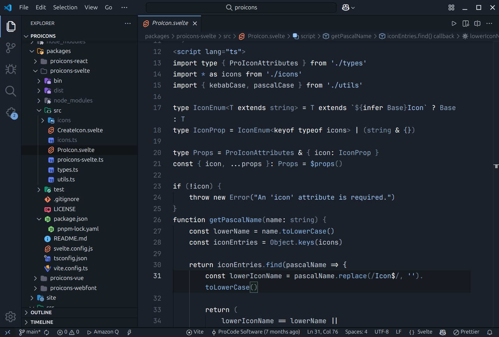
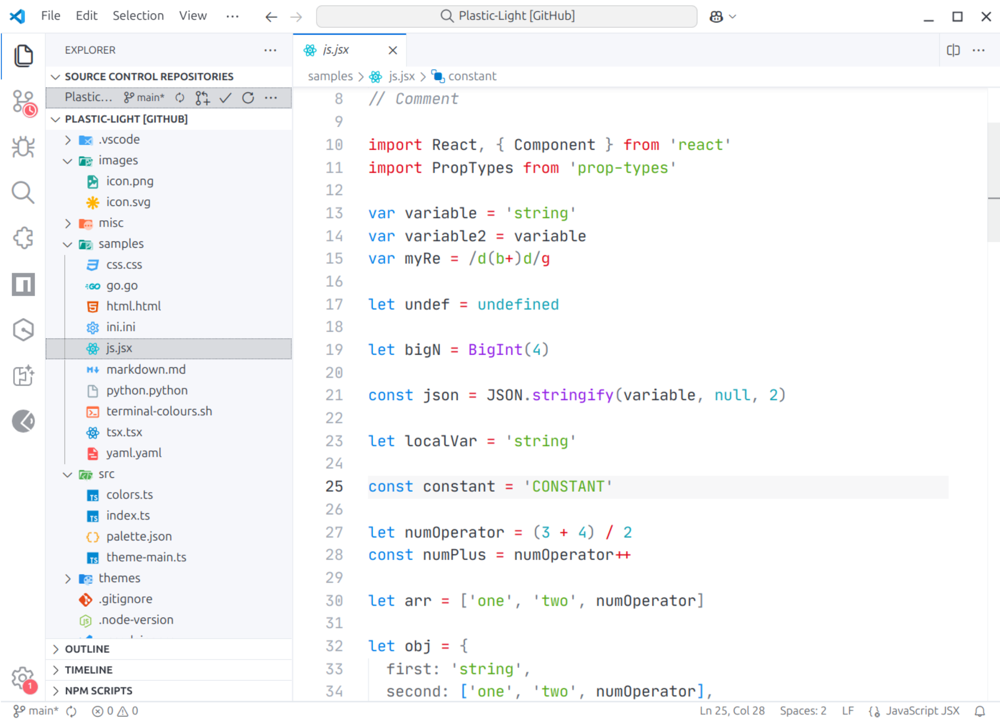

# ProCode VSCode Themes

A collection of Visual Studio Code themes I created

## Themes

- [**🗻 Frost**](./frost-theme/) - An arctic, light-bluish, low-contrast VSCode theme ([Zed port](./frost-zed/))
- [**♻️ Plastic Light**](./plastic-light-theme/) - Light version of Will Stone's [Plastic](https://marketplace.visualstudio.com/items?itemName=will-stone.plastic) theme
- [**🎨 ProCode Theme**](./procode-theme/) - A color theme inspired by Plastic and product icon theme using [ProIcons](https://github.com/ProCode-Software/proicons) (in development)

## Screenshots

Frost:


Frost (Zed):


Plastic Light:


## Building

For the VSCode themes, we use [vsxtools](https://github.com/ProCode-Software/vsxtools) to build and package extensions. It allows use to use variables in theme files, which will be replaced in the output.

1. Clone the repo

```bash
git clone https://github.com/ProCode-Software/vscode-themes.git
```

2. Install dependencies via `bun install`
3. To make changes to themes, run `bun run watch` in the theme directory. To rebuild without watching, run `bun run build`.
4. To package a theme into a VSIX, run `bun run package`.

## License

All extensions are licensed under the [MIT License](./LICENSE).
