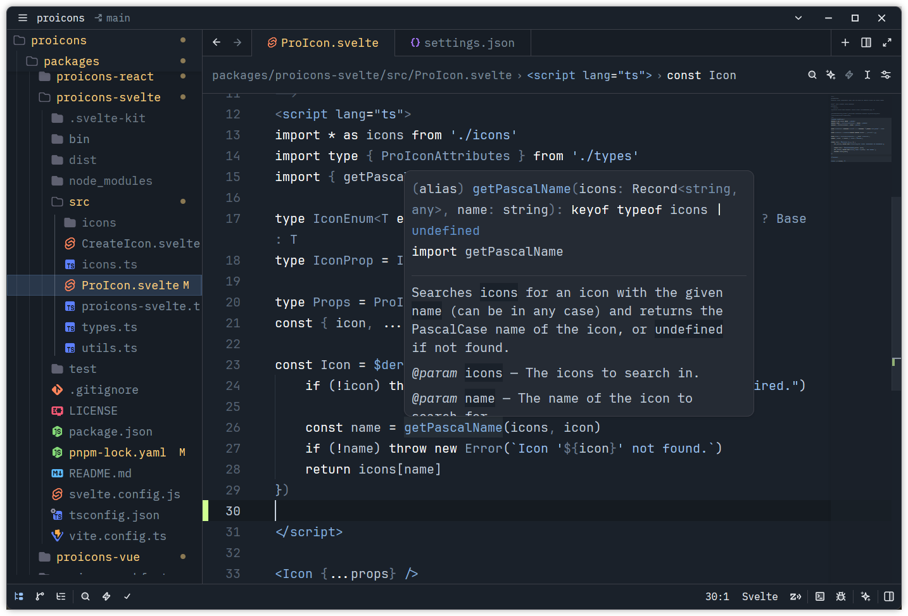
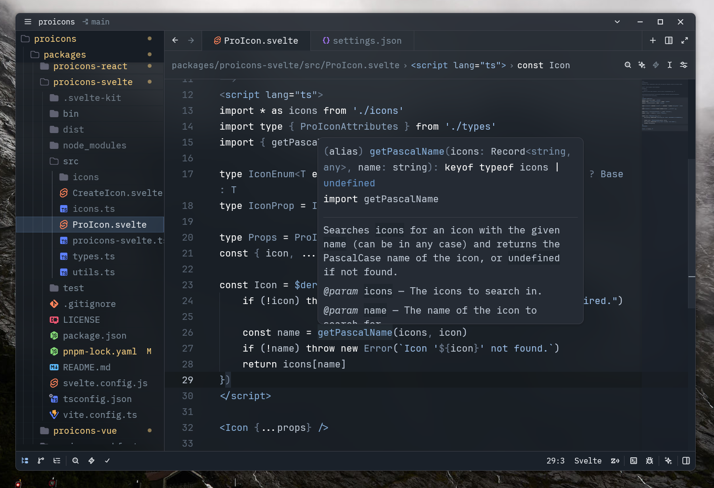

# Frost Theme

An arctic, light-bluish, low-contrast VSCode theme. Ported from VSCode using https://github.com/alanisme/vscode-themes-for-zed.

Inspired by [Nord](https://zed.dev/extensions/nord)

## Screenshots





## Blur Effect

To enable a transparent, blurred background, add the following theme overrides to Zed's `settings.json`:

```json
{
    "theme_overrides": {
        "Frost Dark": {
            "background.appearance": "blurred",
            "background": "#1A212A88",
            "editor.background": "#1A212Aaa",
            "panel.background": "#171D2544",
            "editor.gutter.background": "#1A212Aaa",
            "terminal.background": "#0000",
            "tab_bar.background": "#1A212Aaa",
            "tab.inactive_background": "#0000",
            "tab.active_background": "#1A212A88",
            "toolbar.background": "#1A212Aaa",
            "title_bar.background": "#1A212Acc"
        }
    }
}
```
